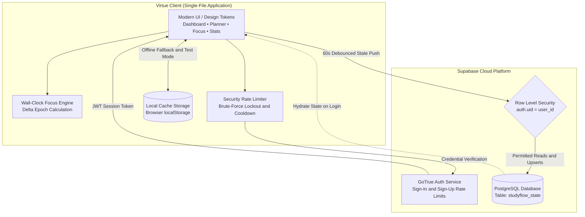

<div align="center">

# ⚡ Virtue
### *Mastery Through Disciplined Focus*

**An offline-first, zero-dependency study workstation engineered with wall-clock drift compensation, gamified progression, and zero-trust Supabase cloud sync.**

[](https://goateddhleminh.github.io/Virtue/)
[](https://github.com/goateddhleminh/Virtue/releases)
[](https://opensource.org/licenses/MIT)
[](https://developer.mozilla.org/)
[](https://supabase.com/)

<br />


<br /><br />

[⚡ Live Demo](https://goateddhleminh.github.io/Virtue/) &nbsp;•&nbsp;
[📖 Architecture & Docs](#-tech-stack--architecture) &nbsp;•&nbsp;
[🛡️ Security & RLS](./supabase_rls_setup.sql) &nbsp;•&nbsp;
[🐛 Report Issue](https://github.com/goateddhleminh/Virtue/issues)

</div>

---

## 🌟 Core Features

- **⏱ Wall-Clock Drift-Free Engine**: Focus and Pomodoro timers leverage millisecond-precise system delta timestamps (`performance.now()` / epoch delta) rather than naive `setInterval`, preventing timer lag when backgrounded, sleeping, or OS-throttled.
- **🛡️ Zero-Trust Supabase Persistence**: Full state synchronization across desktop and mobile devices via `@supabase/supabase-js`, enforced by rigorous PostgreSQL Row Level Security (`auth.uid() = user_id`) and client/server brute-force rate limiters.
- **🗂 High-Yield Academic Planner**: Integrated 5-stage Eisenhower To-Do List (*To Do*, *In Progress*, *Later*, *Blocked*, *Done*) and a 7-day Weekly Schedule with automated Monday UTC+7 rollover and stacked XP rewards.
- **📁 Structured Subject Resource Hub**: Hierarchical folder organization for links, lecture drives, and notes with provider detection (`Google Drive`, `Terabox`, `Notion`, `Dropbox`, `Web Link`) and modal link inspection.
- **📊 0–10 Exam Journal & Life Logs**: Dual-engine reflective tracking for academic test scores with review sliders, mistake retrospectives, and categorized markdown life notes.
- **🎮 Gamified Compounding Loops**: 70 unlockable achievements, evolving pet companions with feeding buffs, a multi-denomination Dice Arena, and a 60 FPS HTML5 Canvas Lucky Wheel.
- **⚡ Instant 1-Click Test Mode**: Sandbox profile with unlocked cosmetics, Level 50 telemetry, and realistic simulated study sessions in `localStorage` without mutating production cloud databases.

---

## 🏗 Tech Stack & Architecture

### Stack Specification

| Domain | Technology | Implementation Details |
| :--- | :--- | :--- |
| **Frontend** | HTML5, CSS3, ES6+ | Single-file architecture (`index.html`), zero node dependencies, zero bundlers |
| **Styling** | Design Tokens / Monochrome | Minimal modern aesthetic, fluid layouts, custom CSS variables, responsive rem scales |
| **Backend / DB** | Supabase (PostgreSQL 15) | Relational user states stored in JSONB schema (`public.studyflow_state`) |
| **Security** | PostgreSQL RLS + Policies | Isolated tenant security, `anon` role revoked, strict `auth.uid() = user_id` rules |
| **Graphics & Audio** | Canvas 2D + Web Audio API | Particle bursts, animated Lucky Wheel spinner, synthesized completion audio chimes |
| **DevOps / CI** | GitHub Actions | Automated zero-latency deployment to GitHub Pages on every `main` push |

### System Data Flow



---

## ⚡ Frictionless Quick Start (< 60s Setup)

Virtue runs completely natively in any modern web browser. There is **no build step, no npm install, and no transpilation required**.

### Prerequisites

- Modern Web Browser: Google Chrome >= 110, Mozilla Firefox >= 115, Microsoft Edge >= 110, or Safari >= 16.
- Optional: A free [Supabase](https://supabase.com/) account if configuring custom backend synchronization.

### 1. Clone & Run Locally

```bash
# Clone the repository
git clone https://github.com/goateddhleminh/Virtue.git

# Navigate into the project directory
cd Virtue

# Launch directly in your default browser (macOS / Linux / Windows)
open index.html        # macOS
xdg-open index.html    # Linux
start index.html       # Windows PowerShell / CMD
```

Or serve via any static HTTP development server:

```bash
# Using Python 3
python -m http.server 3000

# Using Node.js npx
npx serve .
```

Visit `http://localhost:3000` to interact with the workstation.

### 2. Environment & Config Variables

Because Virtue is a zero-build client app, configuration constants reside at the top of the script tag in `index.html`:

| Variable | Type | Description | Default / Fallback |
| :--- | :--- | :--- | :--- |
| `PRESET_SUPABASE_URL` | `String` | Supabase project REST URL | `https://szsxenpcyadgfpmwivqb.supabase.co` |
| `PRESET_SUPABASE_KEY` | `String` | Supabase Anon/Publishable Key | Public client anon key |
| `AUTH_RATE_LIMIT_KEY` | `String` | LocalStorage key for rate-limiting | `virtue_auth_rate_limit_v1` |
| `TIMEZONE_OFFSET` | `Number` | Fixed target timezone for streak rollover | `GMT+7` (Ho Chi Minh City) |

---

## 📁 Project Directory Tree

```ascii
Virtue/
├── .github/
│   └── workflows/
│       └── static.yml           # Automated deployment workflow to GitHub Pages
├── index.html                   # Core single-file application (UI, Styles, Logic)
├── supabase_rls_setup.sql       # Production SQL migration: RLS policies & permissions
├── README.md                    # Project documentation & engineering specifications
├── .gitignore                   # Version control exclusion rules
└── screenshot_*.png             # Visual assets & responsive UI verification previews
```

---

## 🛡️ Database & Security Architecture

The app uses standard public client keys with **Row Level Security (RLS)** strictly enforcing zero tenant data leakage.

To instantiate the schema on your own Supabase instance, execute [`supabase_rls_setup.sql`](./supabase_rls_setup.sql) in the Supabase SQL Editor:

```sql
-- 1. Create Tenant Table
CREATE TABLE IF NOT EXISTS public.studyflow_state (
  user_id UUID PRIMARY KEY REFERENCES auth.users(id) ON DELETE CASCADE,
  data JSONB NOT NULL DEFAULT '{}'::jsonb,
  updated_at TIMESTAMPTZ NOT NULL DEFAULT timezone('utc'::text, now())
);

-- 2. Enable & Enforce RLS
ALTER TABLE public.studyflow_state ENABLE ROW LEVEL SECURITY;
ALTER TABLE public.studyflow_state FORCE ROW LEVEL SECURITY;

-- 3. Strict Isolated Tenant Policies
CREATE POLICY "Users can read own studyflow_state" 
ON public.studyflow_state FOR SELECT TO authenticated 
USING (auth.uid() = user_id);

CREATE POLICY "Users can insert own studyflow_state" 
ON public.studyflow_state FOR INSERT TO authenticated 
WITH CHECK (auth.uid() = user_id);

CREATE POLICY "Users can update own studyflow_state" 
ON public.studyflow_state FOR UPDATE TO authenticated 
USING (auth.uid() = user_id) WITH CHECK (auth.uid() = user_id);

-- 4. Strip Anonymous Access
REVOKE ALL ON public.studyflow_state FROM anon;
GRANT SELECT, INSERT, UPDATE, DELETE ON public.studyflow_state TO authenticated;
```

---

## 🗺️ Roadmap & Milestones

- [x] **v1.0**: Core stopwatch & Pomodoro timer engines with persistent local storage.
- [x] **v2.0**: Academic resource hub, exam mark slider (0–10 scale), and life journal.
- [x] **v2.2**: Supabase multi-device synchronization with optimistic UI updating.
- [x] **v2.3**: Virtue minimal monochrome design system with responsive cards and clean typography.
- [x] **v2.4**: Client/server security hardening: PostgreSQL RLS policies & brute-force rate limiters.
- [ ] **v2.5**: WebRTC peer-to-peer virtual study rooms & ambient binaural beats audio generator.
- [ ] **v2.6**: Bi-directional export/import for Anki flashcard decks and Notion databases.

---

## 🤝 Contributing

Contributions are welcome! Please follow these standards:

1. **Fork** the repository and create your branch: `git checkout -b feature/amazing-feature`.
2. **Adhere to Zero-Build Philosophy**: Keep all styles, markup, and scripts clean, accessible, and self-contained within `index.html`.
3. **Commit Your Changes**: Follow [Conventional Commits](https://www.conventionalcommits.org/) (`feat:`, `fix:`, `docs:`, `refactor:`).
4. **Push & Open a Pull Request**: Submit your PR targeting `main`.

---

## 📄 License & Attribution

Distributed under the **MIT License**. See `LICENSE` or [opensource.org/licenses/MIT](https://opensource.org/licenses/MIT) for terms of use.

Designed and engineered with care by [@goateddhleminh](https://github.com/goateddhleminh).
